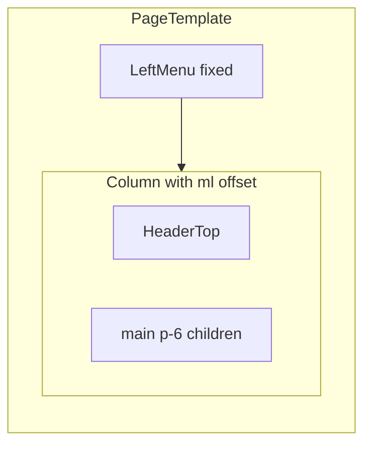

# Page Template Implementation Plan

> **For agentic workers:** Use subagent-driven-development or executing-plans task-by-task.

**Goal:** Ship a reusable page shell organism (`PageTemplate`) that every Teamio page can wrap around page content.

**Architecture:** Compositional shell — `leftMenu` / `headerTop` prop objects + `children`. Forces `LeftMenu` to `position="fixed"`, syncs collapsed state so the content column margin switches between `tm-ml-left-menu` (15rem) and `tm-ml-left-menu-collapsed` (4.5rem). Content is a padded `<main>` only (no built-in `Container`).

**Tech Stack:** React + TypeScript, Tailwind (`tm-` prefix), Storybook 10, Vitest — same patterns as [`LeftMenu`](teamio-prototype-starter/src/components/LeftMenu/) and [`HeaderTop`](teamio-prototype-starter/src/components/HeaderTop/).

**Repo:** [`teamio-prototype-starter`](teamio-prototype-starter/) only (not the npm design system package).

## Decisions (locked)

- Storybook title: `Page/Page Template`
- API: prop objects `leftMenu` + `headerTop` + `children` (option A)
- Content: `<main className="… tm-p-6">` — pages supply their own Container/tables/cards
- Branch: `PageTemplate` from `main`
- LeftMenu always fixed inside this template

## Layout



Reference composition already exists as story-only glue in [`HeaderTop.stories.tsx` `WithLeftMenu`](teamio-prototype-starter/src/components/HeaderTop/HeaderTop.stories.tsx) (uses `position="static"`). PageTemplate replaces that with fixed menu + proper offset.

## Files

| File | Role |
|------|------|
| `src/components/PageTemplate/PageTemplate.tsx` | Shell component |
| `src/components/PageTemplate/pageTemplateClass.ts` | Class helpers (optional, match HeaderTop pattern) |
| `src/components/PageTemplate/index.ts` | Re-exports |
| `src/components/PageTemplate/PageTemplate.stories.tsx` | `title: 'Page/Page Template'` |
| `src/components/PageTemplate/PageTemplate.test.tsx` | Unit tests |
| `src/components/index.ts` | Barrel export |
| `.storybook/preview.ts` | Add `'Page'` to `storySort.order` (after Complex components, before App) |
| `docs/superpowers/specs/2026-08-17-page-template-design.md` | Approved design spec |
| `docs/superpowers/plans/2026-08-17-page-template.md` | This plan (saved on execute) |
| `README.md` | Mention Page category briefly |

## API sketch

```ts
export interface PageTemplateProps extends StyleProps, HTMLAttributes<HTMLDivElement> {
  leftMenu: LeftMenuProps
  headerTop: HeaderTopProps
  children?: ReactNode
}
```

Collapse sync (required for correct offset when menu toggles):

- Track effective collapsed from `leftMenu.isCollapsed` (controlled) or internal state (`defaultCollapsed`)
- Pass through `onCollapsedChange` to caller
- Force `position="fixed"` on LeftMenu (ignore `leftMenu.position` if passed)
- Content column: `cn(collapsed ? 'tm-ml-left-menu-collapsed' : 'tm-ml-left-menu', …)`

Root: `tm-min-h-screen`; right column: `tm-flex tm-min-h-screen tm-min-w-0 tm-flex-1 tm-flex-col`; main: `tm-flex-1 tm-bg-cover-light tm-p-6` (align with existing stories).

## Stories

Fullscreen layout. Czech demo copy. Reuse demo menu items / user from HeaderTop stories.

1. **Default** — placeholder Typography in main
2. **WithTable** — sample Table in children
3. **WithCards** — sample Cards
4. **Collapsed** — `leftMenu.isCollapsed: true`
5. **Interactive** — live collapse + search state

## Tests

- Renders LeftMenu + HeaderTop + children
- Content column uses expanded margin by default; collapsed margin when collapsed
- Forwards `onCollapsedChange` when toggle is used
- Does not require Container

## Out of scope

- Changes to LeftMenu / HeaderTop APIs
- Mobile responsive drawer
- Built-in breadcrumbs / page title / Container
- Publishing to `@almacareer/teamio-ui-components`
